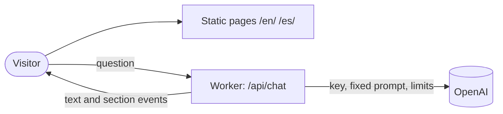

<h1 align="center">Jaume Cortés · Portfolio</h1>

<p align="center">
  Personal site of an AI Engineer, in English and Spanish, with an assistant that answers
  questions about the profile and scrolls the page to the answer. The model key never leaves
  the server.
</p>

<p align="center">
  <a href="#features">Features</a> ·
  <a href="#tech-stack">Tech stack</a> ·
  <a href="#architecture">Architecture</a> ·
  <a href="#getting-started">Getting started</a> ·
  <a href="#documentation">Documentation</a>
</p>

---

## Features

**Site**
- One page per language (`/en/`, `/es/`), prerendered; `/` redirects to English.
- Profile, experience, projects, skills, education and certifications, laid out like the CV.

**Assistant**
- Answers from the same facts the page shows, as a stream.
- Brings the visitor to the section that covers the answer.

**Security**
- The chat goes through a server endpoint: fixed prompt and model, validated input, origin
  check, per-visitor rate limit, capped answer length.
- Strict Content Security Policy: same-origin scripts, styles and fonts only.

---

## Tech stack

<p>
  
  
  
  
</p>

| Layer | Technology |
|---|---|
| Framework | Astro 5, TypeScript |
| Styles | Plain CSS with custom properties |
| Server | Cloudflare Workers (`@astrojs/cloudflare`, Wrangler 4) |
| Model | OpenAI chat completions |
| Tests | Vitest 3 |

---

## Architecture



Pages are static files. Only two routes run code: `/` (redirect to `/en/`) and `/api/chat`,
the single place that holds the key. The browser sends the visible conversation; the endpoint
decides everything else and forwards only text and a validated section id.

---

## Getting started

Requires Node 22.

```bash
git clone https://github.com/jcm-developer/portfolio.git
cd portfolio
npm install
cp .dev.vars.example .dev.vars   # set OPENAI_API_KEY to enable the assistant
npm run dev                      # http://localhost:4321
```

The site runs without a key; the assistant then answers that it is unavailable.

Environment variables, deploy and CI: [docs/operations.md](docs/operations.md).

---

## Project structure

```
portfolio/
├── src/
│   ├── pages/        # Routes: /, /[lang]/, /api/chat, 404
│   ├── components/   # Astro components
│   ├── lib/chat/     # Server-side chat logic and its tests
│   ├── i18n/         # English and Spanish dictionaries
│   └── data/         # Language-neutral profile data
├── public/           # _headers, robots.txt, favicon, CV
├── docs/             # Domains, operations, workflow and decisions
├── DESIGN.md         # Visual system
└── AGENTS.md         # Agent rules and documentation map
```

---

## Documentation

- [AGENTS.md](AGENTS.md): entry point, global rules and the map of where everything lives.
- [docs/](docs/): one file per feature domain, plus code style, workflow, operations and the
  decision log.
- [DESIGN.md](DESIGN.md): palette, type, layout and the hero ribbon.
